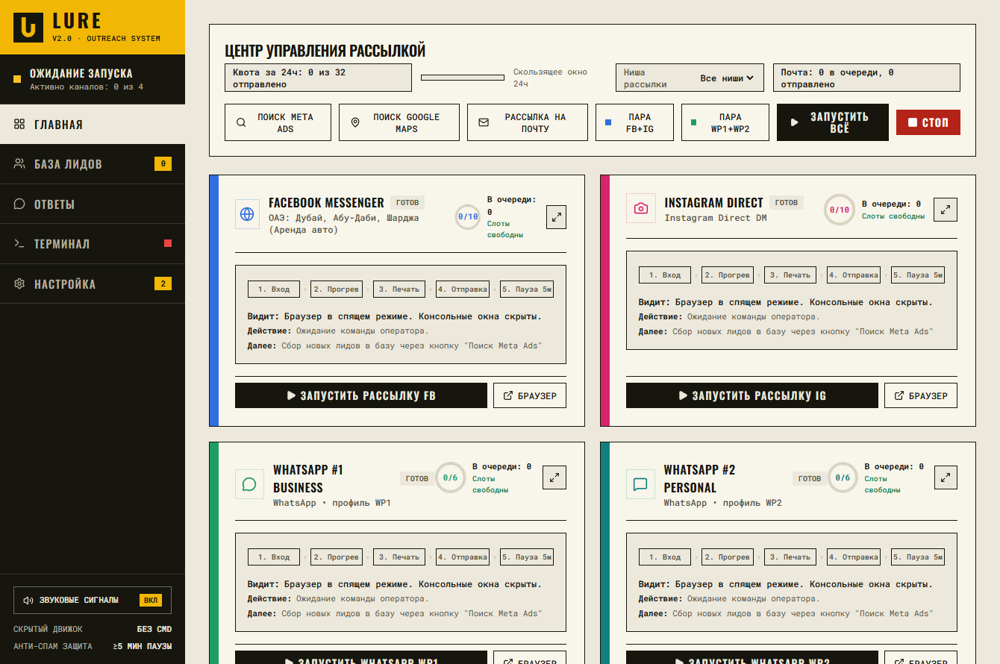
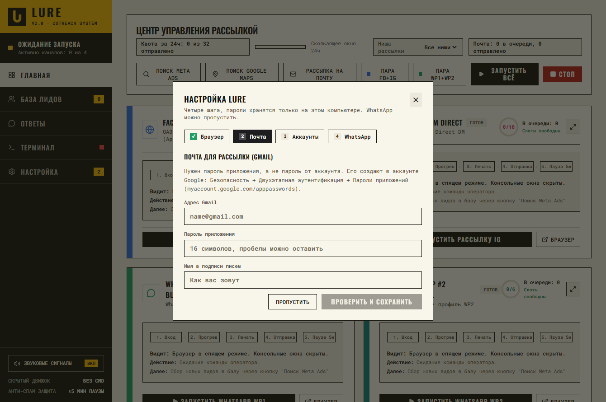
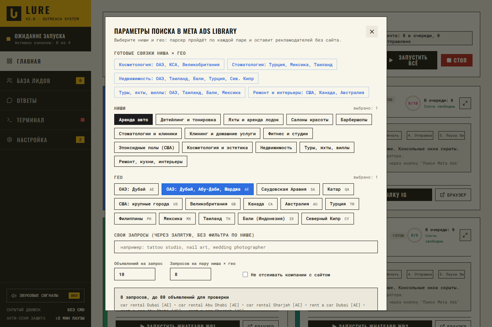
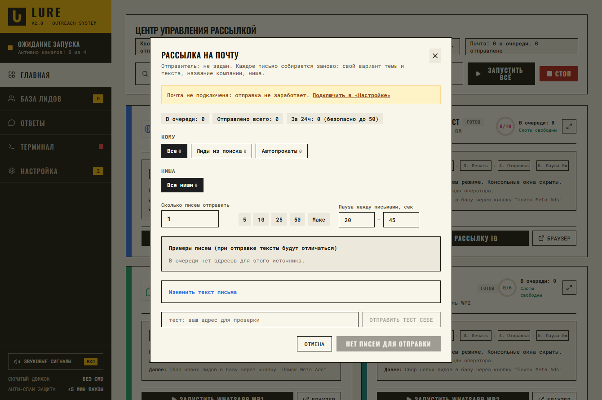

# Lure

[Русская версия](README.ru.md)

Lure is a Windows desktop control panel for a small lead-research and outreach toolkit. It finds businesses that advertise on Meta but have no website, keeps them in a local database, and helps you contact them through Facebook Messenger, Instagram Direct, e-mail and WhatsApp.

Each tool runs as its own process with its own SQLite database. Lure starts and stops them, and shows status, logs and 24-hour metrics in one window.

> **Research and educational project.** Automating messages and browsing on Facebook, Instagram, WhatsApp, Google Maps and Gmail can break those platforms' terms of service and may get your accounts restricted or banned. Unsolicited commercial messages are regulated in many countries (CAN-SPAM, GDPR/PECR, local laws). You are responsible for how you use this code. Use test accounts, keep volumes low, honour opt-outs, and do not use it for spam. The software is provided as is, without warranty.



## What is inside

| Folder | What it does |
| --- | --- |
| `control-hub/` | The Lure app: FastAPI server on `127.0.0.1:8765` and a desktop window (pywebview, Edge app mode as fallback). The interface is currently in Russian. |
| `meta-lead-gen/` | Searches the Meta Ad Library, drops companies that have a website, sends the first message in Messenger / Instagram Direct through Chrome (Playwright over CDP), and runs the e-mail campaign. |
| `whatsapp-outreach/` | Semi-automatic WhatsApp: prepares the chat and the text, a human presses Enter. Uses BitBrowser profiles and is optional. |
| `tests/` | Unit tests (spintax, catalog, e-mail templates, setup wizard). |

Main features:

- **Niche × geo search.** `meta-lead-gen/catalog.json` holds niches (keywords, signals, stop words) and geos. Pick any pairs in the "Meta search" window, or add your own queries.
- **Website policy.** By default only companies without a website are kept (`campaign.website_policy`: `no_website_only` or `any`).
- **First message as a spintax template**, with one scheme for all niches (`core/spintax.py`).
- **E-mail campaign** through Gmail SMTP with per-recipient spintax, a daily-safe limit, a send log, and a text editor in the UI (`email_template.json`).
- **First-run setup wizard** for Chrome, Gmail, Facebook / Instagram login and optional WhatsApp.

| Setup wizard | Meta search | E-mail campaign |
| --- | --- | --- |
|  |  |  |

## Requirements

- Windows 10/11 (paths and launchers are Windows-specific)
- Python 3.10 or newer, added to `PATH`
- Google Chrome
- A Gmail account with an [app password](https://myaccount.google.com/apppasswords) for the e-mail part
- Optional: BitBrowser for the WhatsApp part

## Install and run

1. Download or clone the repository. Keep the three tool folders together: Lure finds them relative to its own location.
2. Double-click `START.bat`. The first run creates `meta-lead-gen\venv` and installs all dependencies (a few minutes).
3. Follow the setup wizard: Chrome is detected, you enter the Gmail address and app password, then log in to Facebook and Instagram once in the Chrome windows Lure opens. Profiles are stored under `meta-lead-gen/data/profiles/`. WhatsApp can be skipped.
4. Click "Meta search", choose niches and geos, and start.

Everything the app creates (databases, `config.json`, browser profiles, logs) stays on your machine and is excluded by `.gitignore`. Your Gmail app password is written only to the local `config.json`.

## Configuration

- `meta-lead-gen/config.json` and `whatsapp-outreach/config.json` are created from the `*.example.json` files on first start.
- Demo links: set `demo_base_url` in `meta-lead-gen/config.json` or the environment variable `LURE_DEMO_BASE_URL`. Empty means no demo link in messages.
- `LURE_CHROME_PATH` points to `chrome.exe` if Chrome is installed in a non-standard place.
- Daily limits and delays live in `config.json` (`limits`, `delays`, `email`). Defaults are deliberately low.
- `meta-lead-gen/email_template.json` holds the e-mail texts. Spintax `{a|b|c}` is expanded for every message, `[BUSINESS]`, `[SOURCE]`, `{sender}` and `{demo_link}` are substituted.

## Development

```bash
pip install -r requirements-dev.txt fastapi uvicorn pydantic aiohttp rich
ruff check .
pytest
```

GitHub Actions runs the same two commands on Windows and Linux.

Note: `control-hub/core` and `meta-lead-gen/core` are different packages with the same name, so Lure loads the Meta modules by file path with `importlib`.

## License

[MIT](LICENSE), copyright (c) 2026 jstivn.
