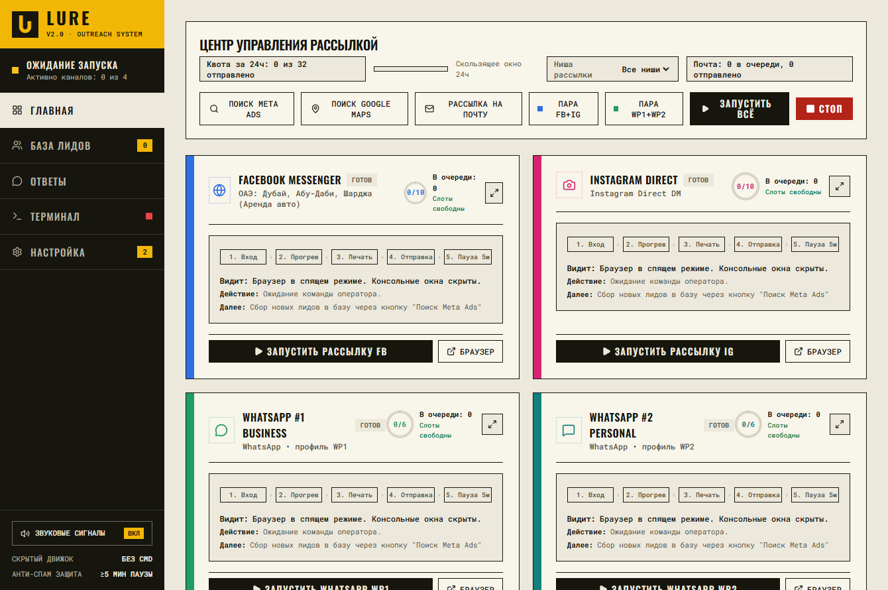
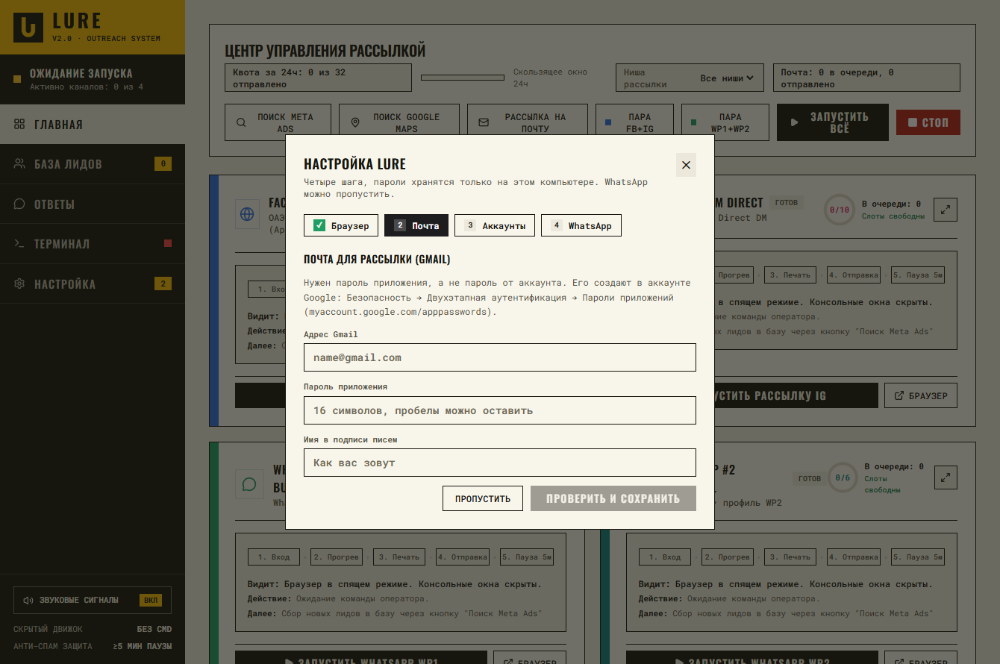
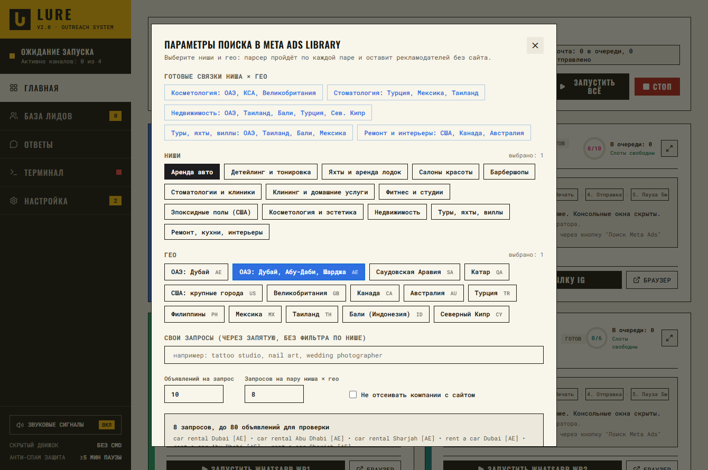
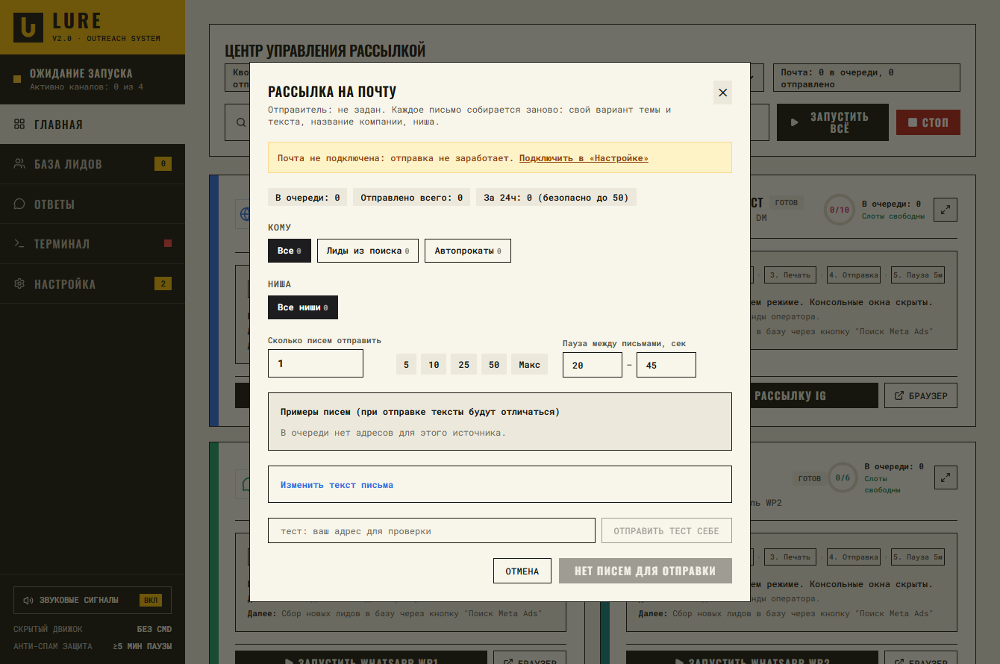

# Lure

[English version](README.md)

Lure это десктопная панель управления для Windows: небольшой набор инструментов для поиска клиентов и рассылки. Она находит компании, которые дают рекламу в Meta, но не имеют сайта, хранит их в локальной базе и помогает написать им в Facebook Messenger, Instagram Direct, на почту и в WhatsApp.

Каждый инструмент работает как отдельный процесс со своей базой SQLite. Lure запускает и останавливает их и показывает статус, логи и метрики за 24 часа в одном окне.

> **Исследовательский и учебный проект.** Автоматизация сообщений и действий в Facebook, Instagram, WhatsApp, Google Maps и Gmail может нарушать правила этих платформ, и ваши аккаунты могут получить ограничения или бан. Рассылка коммерческих сообщений без согласия регулируется законами многих стран (CAN-SPAM, GDPR/PECR и местные). Ответственность за использование кода на вас. Берите тестовые аккаунты, держите малые объёмы, соблюдайте отписки и не используйте код для спама. Программа предоставляется как есть, без гарантий.



## Что внутри

| Папка | Что делает |
| --- | --- |
| `control-hub/` | Приложение Lure: сервер FastAPI на `127.0.0.1:8765` и окно (pywebview, запасной вариант: Edge в режиме приложения). Интерфейс пока на русском. |
| `meta-lead-gen/` | Ищет рекламодателей в Meta Ad Library, отсеивает компании с сайтом, отправляет первое сообщение в Messenger и Instagram Direct через Chrome (Playwright по CDP), ведёт почтовую рассылку. |
| `whatsapp-outreach/` | Полуавтоматический WhatsApp: скрипт готовит чат и текст, Enter нажимает человек. Работает через профили BitBrowser, необязателен. |
| `tests/` | Тесты (спинтакс, каталог, шаблоны писем, мастер настройки). |

Возможности:

- **Поиск по парам «ниша × гео».** В `meta-lead-gen/catalog.json` лежат ниши (ключевые слова, сигналы, стоп-слова) и гео. В окне «Поиск Meta Ads» выбираете пары или вводите свои запросы.
- **Политика сайта.** По умолчанию остаются только компании без сайта (`campaign.website_policy`: `no_website_only` или `any`).
- **Первое сообщение по шаблону со спинтаксом**, одна схема для всех ниш (`core/spintax.py`).
- **Почтовая рассылка** через Gmail SMTP: свой вариант текста для каждого письма, безопасный дневной лимит, журнал отправок, редактор текста в интерфейсе (`email_template.json`).
- **Мастер первого запуска**: Chrome, Gmail, вход в Facebook и Instagram, WhatsApp по желанию.

| Мастер настройки | Поиск Meta | Рассылка на почту |
| --- | --- | --- |
|  |  |  |

## Что нужно

- Windows 10/11 (пути и запуск рассчитаны на Windows)
- Python 3.10 или новее, добавленный в `PATH`
- Google Chrome
- Аккаунт Gmail с [паролем приложения](https://myaccount.google.com/apppasswords) для почтовой части
- По желанию: BitBrowser для WhatsApp

## Установка и запуск

1. Скачайте или клонируйте репозиторий. Три папки инструментов должны лежать рядом: Lure ищет их относительно своего расположения.
2. Дважды щёлкните `START.bat`. При первом запуске он создаст `meta-lead-gen\venv` и поставит все зависимости (несколько минут).
3. Пройдите мастер настройки: Chrome находится сам, вы вводите адрес Gmail и пароль приложения, затем один раз входите в Facebook и Instagram в окнах Chrome, которые откроет Lure. Профили лежат в `meta-lead-gen/data/profiles/`. WhatsApp можно пропустить.
4. Нажмите «Поиск Meta Ads», выберите ниши и гео и запустите.

Всё, что создаёт программа (базы, `config.json`, профили браузера, логи), остаётся на вашем компьютере и исключено через `.gitignore`. Пароль приложения Gmail записывается только в локальный `config.json`.

## Настройка

- `meta-lead-gen/config.json` и `whatsapp-outreach/config.json` создаются из `*.example.json` при первом запуске.
- Демо-ссылки: `demo_base_url` в `meta-lead-gen/config.json` или переменная окружения `LURE_DEMO_BASE_URL`. Пусто значит без демо-ссылки в сообщениях.
- `LURE_CHROME_PATH` указывает на `chrome.exe`, если Chrome стоит в нестандартном месте.
- Дневные лимиты и паузы лежат в `config.json` (`limits`, `delays`, `email`). Значения по умолчанию намеренно небольшие.
- Тексты писем лежат в `meta-lead-gen/email_template.json`. Спинтакс `{a|b|c}` раскрывается для каждого письма, подставляются `[BUSINESS]`, `[SOURCE]`, `{sender}` и `{demo_link}`.

## Разработка

```bash
pip install -r requirements-dev.txt fastapi uvicorn pydantic aiohttp rich
ruff check .
pytest
```

GitHub Actions запускает те же две команды на Windows и Linux.

Пакеты `control-hub/core` и `meta-lead-gen/core` называются одинаково, поэтому Lure подгружает модули Meta по пути к файлу через `importlib`.

## Лицензия

[MIT](LICENSE), copyright (c) 2026 jstivn.
